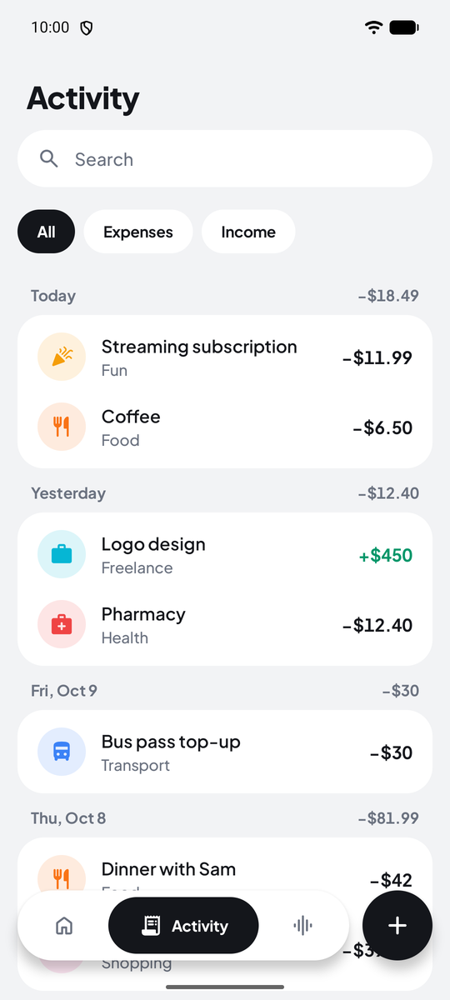

# OpenTracker

**A simple, open-source budget tracker for Android that you can talk to.**

Log what you spend by voice or by hand, see where your money goes each month, and ask about it. The assistant runs through an AI coding CLI on your own computer, like Antigravity, Claude Code or Codex, signed in with your own account, so there are no API keys to manage.

- **Talk to it.** Say "spent 250 on lunch" and it's recorded. Ask "how am I doing this month?" or "where can I cut back?" and hear the answer. Anything it changes comes with an Undo button.
- **Deep analysis.** The AI on your computer studies a year of your transactions and writes a report: trends, recurring payments, unusual spending and ways to save.
- **Budgets that make sense.** A monthly budget and per-category budgets, what's left to spend per day, and where the month is heading.
- **Yours.** No account, no ads, no tracking. Your data stays on your phone, and the AI features only run when you use them.
- **Free software,** licensed GPL-3.0-or-later.

<p>
  
  
  
  
</p>

The screenshots use demo data.

## Install

OpenTracker runs on Android 8.0 and newer. Download `OpenTracker-<version>.apk` from the [latest release](https://github.com/Geanyl17/opentracker/releases/latest) and open it on your phone; Android asks you to allow installing apps from your browser or file manager the first time. Releases are signed with the same key, so newer versions install over older ones and keep your data.

## Connect your PC

The tracking works without any of this. The assistant and deep analysis need a computer with one of these CLIs, which the phone reaches through a small relay:

- [Antigravity](https://antigravity.google) (`agy`), usually the cheapest for these short, frequent requests
- [Claude Code](https://claude.com/claude-code) (`claude`)
- [Codex](https://github.com/openai/codex) (`codex`)

1. On your computer, install one of them and run it once to sign in.
2. From the OpenTracker folder, start the relay:

   ```bash
   python3 relay/opentracker_relay.py
   ```

   It uses the first CLI it finds, in the order above. To choose, add `--cli agy`, `--cli claude` or `--cli codex`, and `--path` if the CLI isn't on your `PATH`. The relay needs Python 3.10 or newer and `openssl`, and prints an address, a pairing code and a certificate fingerprint.
3. In the app, open **Settings > Your PC**, enter the address and the code, and tap **Pair**. On Android 17, allow access to devices on your local network when asked.
4. Go to the **Assistant** tab and tap the mic, or tap the mic on the home screen.

The phone has to reach your computer, so use the same Wi-Fi. Away from home, the relay also listens on your [Tailscale](https://tailscale.com) address if both devices are on your tailnet.

To start the relay whenever you log in, run `python3 relay/opentracker_relay.py --install-service`. `--pairing` shows the pairing details again, and `--new-code` makes a new code, which unpairs every phone.

By default the relay picks a quick model for the assistant and a stronger one for deep analysis. To choose others, go to **Settings > AI on your PC**, which lists the models your CLI offers. Long-press the app icon for shortcuts that go straight to voice input or a new transaction.

### What goes where

- **Phone to computer:** HTTPS with the relay's own certificate, which the app pins when you pair, and every request needs the pairing code. The code and certificate are stored only on the phone and left out of backups.
- **Computer to the AI provider:** the relay runs your CLI with your own sign-in, so messages go to Google, Anthropic or OpenAI like any other conversation you have with that CLI, and count against your plan. Each message carries your question with a summary of your data: categories and budgets, monthly totals for the past year, and the transactions of the last three months. Deep analysis sends a year of transactions. Antigravity keeps the conversations in its history on your computer; Claude Code and Codex run without saving sessions.
- **Nothing else on your computer:** the relay turns off every tool the CLI has, so the model can't read files, browse or run commands there. Antigravity runs a custom agent without tools, Claude Code runs with no tools and without your settings, plugins or MCP servers, and Codex runs in a read-only sandbox with its shell, web search and other tools off and without your config.
- **Voice:** speech is turned into text by your phone's speech recognizer (on most phones, Google's), and replies are read aloud by the phone's text-to-speech.

The relay always runs the CLI itself rather than reusing its login. Signing other apps in with a CLI's login can break the provider's terms, and Google has suspended Antigravity accounts for it.

## Backups

**Settings → Export to CSV** saves every transaction as a spreadsheet file (`date,type,amount,category,note`). **Import from CSV** reads the same format back, skips transactions that are already there, and creates any missing categories.

## Building

You need JDK 17 or newer and the Android SDK. [Android Studio](https://developer.android.com/studio) includes both.

```bash
./gradlew :app:installDebug     # build and install on a connected phone or emulator
./gradlew check                 # run tests and lint
./gradlew :app:assembleRelease  # build a signed release APK
```

Release builds are signed with the keystore that `keystore.properties` points to (`storeFile`, `storePassword`, `keyAlias`, `keyPassword`). It isn't in the repository, so without it the release APK comes out unsigned.

## How it's built

Kotlin, Jetpack Compose with Material 3, Room and DataStore. The relay is a single Python file that only uses the standard library.

| Folder | What's in it |
| --- | --- |
| `data/` | The Room database, settings, money formatting, CSV import and export, monthly summaries |
| `ai/` | The relay client, the assistant and the changes it can make, the deep analysis |
| `voice/` | Speech recognition and text-to-speech |
| `ui/` | The Compose screens |

All under `app/src/main/kotlin/io/github/geanyl17/opentracker/`. The relay is `relay/opentracker_relay.py`.

## License

OpenTracker is free software: you can redistribute it and/or modify it under the terms of the [GNU General Public License](LICENSE), version 3 or (at your option) any later version.

The typeface is [Plus Jakarta Sans](https://github.com/tokotype/PlusJakartaSans), under the [SIL Open Font License 1.1](docs/licenses/PlusJakartaSans-OFL.txt). Icons are [Material Symbols](https://github.com/google/material-design-icons) by Google, under the Apache License 2.0.
