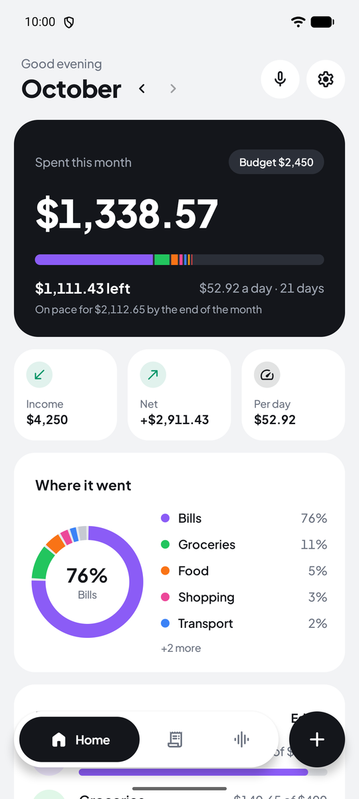
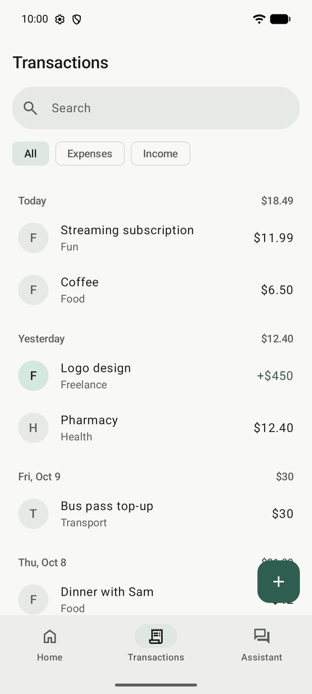
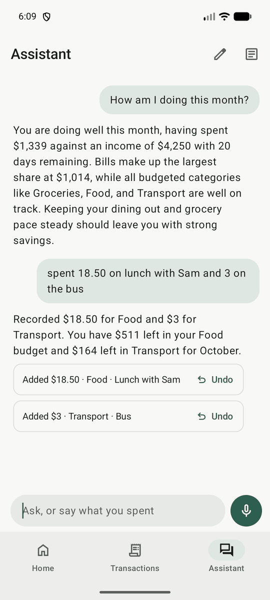
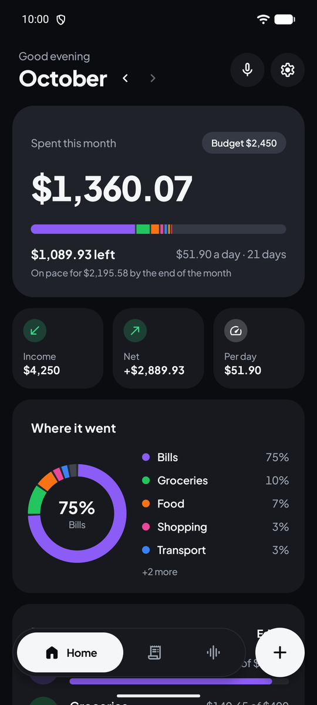

# OpenTracker

**A simple, open-source budget tracker for Android that you can talk to.**

Log what you spend by voice or by hand, see where your money goes each month, and ask about it. The assistant runs on Google's Antigravity CLI on your own computer, signed in with your Google account, so there are no API keys to manage.

- **Talk to it.** Say "spent 250 on lunch" and it's recorded. Ask "how am I doing this month?" or "where can I cut back?" and hear the answer. Anything it changes comes with an Undo button.
- **Deep analysis.** Antigravity studies a year of your transactions and writes a report: trends, recurring payments, unusual spending and ways to save.
- **Budgets that make sense.** A monthly budget and per-category budgets, what's left to spend per day, and where the month is heading.
- **Yours.** No account, no ads, no tracking. Your data stays on your phone, and the AI features only run when you use them.
- **Free software,** licensed GPL-3.0-or-later.

<p>
  
  
  
  
</p>

The screenshots use demo data.

## Install

OpenTracker runs on Android 8.0 and newer. Build it yourself (see [Building](#building)), or download the debug APK from the latest successful run under **Actions** on GitHub and open it on your phone.

## Connect Antigravity

The tracking works without any of this. The assistant and deep analysis need a computer with the [Antigravity CLI](https://antigravity.google) (`agy`), which the phone reaches through a small relay:

1. On your computer, install the Antigravity CLI and run `agy` once to sign in with your Google account.
2. From the OpenTracker folder, start the relay:

   ```bash
   python3 relay/opentracker_relay.py
   ```

   It needs Python 3.10 or newer and `openssl`, and prints an address, a pairing code and a certificate fingerprint.
3. In the app, open **Settings > Your PC**, enter the address and the code, and tap **Pair**. On Android 17, allow access to devices on your local network when asked.
4. Go to the **Assistant** tab and tap the mic, or tap the mic on the home screen.

The phone has to reach your computer, so use the same Wi-Fi. Away from home, the relay also listens on your [Tailscale](https://tailscale.com) address if both devices are on your tailnet.

To start the relay whenever you log in, run `python3 relay/opentracker_relay.py --install-service`. `--pairing` shows the pairing details again, and `--new-code` makes a new code, which unpairs every phone.

The assistant model and the analysis model are picked in Settings, from the models your Antigravity plan offers. Long-press the app icon for shortcuts that go straight to voice input or a new transaction.

### What goes where

- **Phone to computer:** HTTPS with the relay's own certificate, which the app pins when you pair, and every request needs the pairing code. The code and certificate are stored only on the phone and left out of backups.
- **Computer to Google:** the relay runs `agy` with your Antigravity sign-in, so messages go to Google like any other Antigravity conversation and count against your Antigravity quota. Each message carries your question with a summary of your data: categories and budgets, monthly totals for the past year, and the transactions of the last three months. Deep analysis sends a year of transactions. The conversations stay in `agy`'s history on your computer.
- **Nothing else on your computer:** the relay runs `agy` as a custom agent without tools, so the model can't read files, browse or run commands there.
- **Voice:** speech is turned into text by your phone's speech recognizer (on most phones, Google's), and replies are read aloud by the phone's text-to-speech.

The app only uses Antigravity through Google's own CLI. Signing other apps in with an Antigravity login breaks Google's terms, and accounts have been suspended for it.

## Backups

**Settings → Export to CSV** saves every transaction as a spreadsheet file (`date,type,amount,category,note`). **Import from CSV** reads the same format back, skips transactions that are already there, and creates any missing categories.

## Building

You need JDK 17 or newer and the Android SDK. [Android Studio](https://developer.android.com/studio) includes both.

```bash
./gradlew :app:installDebug   # build and install on a connected phone or emulator
./gradlew check               # run tests and lint
```

Each CI run on GitHub also builds a debug APK, which you can download from the run's page under **Actions**.

## How it's built

Kotlin, Jetpack Compose with Material 3, Room and DataStore. The relay is a single Python file that only uses the standard library.

| Folder | What's in it |
| --- | --- |
| `data/` | The Room database, settings, money formatting, CSV import and export, monthly summaries |
| `ai/` | The relay client, the assistant and the changes it can make, the deep analysis |
| `voice/` | Speech recognition and text-to-speech |
| `ui/` | The Compose screens |

All under `app/src/main/kotlin/io/github/geanyl17/opentracker/`. The relay is `relay/opentracker_relay.py`.

## License

OpenTracker is free software: you can redistribute it and/or modify it under the terms of the [GNU General Public License](LICENSE), version 3 or (at your option) any later version.

Icons are [Material Symbols](https://github.com/google/material-design-icons) by Google, under the Apache License 2.0.
